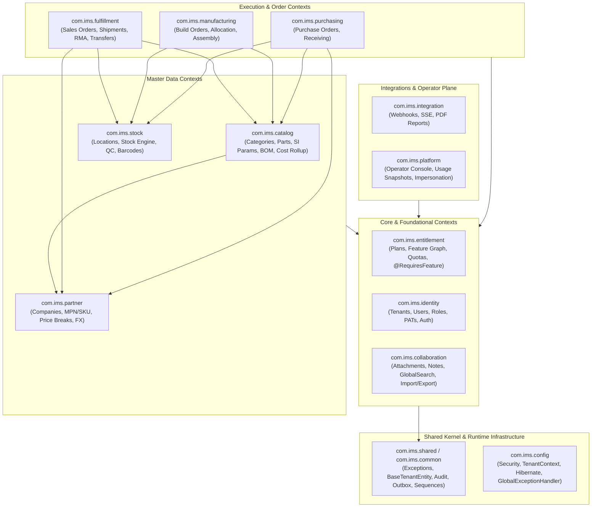

# 01 — System Overview & Modular Monolith Architecture

`ims-core-management` is structured as a **Modular Monolith** following **Clean / Hexagonal Architecture** per bounded context. Every business capability is isolated into a dedicated package under `com.ims` with explicit Service Provider Interfaces (`spi`) for cross-module communication.

---

## 1. Bounded Contexts

---

## 2. Hexagonal Package Layout per Module

Each migrated module (`entitlement`, `identity`, `collaboration`, `catalog`, `partner`, `stock`, `purchasing`, `manufacturing`, `fulfillment`) follows a consistent 5-layer package layout:

| Layer | Package | Responsibility | Allowed Dependencies |
| :--- | :--- | :--- | :--- |
| **API (Driving Adapter)** | `com.ims.<module>.api` | `@RestController` endpoints, `@Valid` request/response DTOs, `@RequiresFeature` & `@PreAuthorize` | `application`, `spi`, `domain` (read-only DTO mapping), `shared` |
| **SPI (Public Contract)** | `com.ims.<module>.spi` | Cross-module ports (interfaces), immutable records/DTOs, plugin SPIs (`SearchContributor`, `ImportTargetHandler`, `ReportDataProvider`, etc.) | `shared` (never internal `domain` or `infrastructure`) |
| **Application (Use Cases)** | `com.ims.<module>.application` | `@Transactional` command services, CQRS-lite batch read services, `application.adapter` driving adapters | `domain`, `spi`, `shared`, sibling `<other>.spi` |
| **Domain (Core Model)** | `com.ims.<module>.domain` | JPA-mapped aggregate roots (`domain.model`), status enums, pure domain validators/calculators (`domain.service`) | `common`/`shared` only (**must never** depend on `api` or `infrastructure`) |
| **Infrastructure (Driven Adapter)** | `com.ims.<module>.infrastructure` | Spring Data JPA repositories (`infrastructure.persistence`), Aspects, outbound/SPI adapters (`infrastructure.adapter`) | `domain`, `spi`, `application`, `shared` |

---

## 3. Dependency Rules & Future Service Extraction

- **Sibling Isolation**: Execution modules (`purchasing`, `manufacturing`, `fulfillment`) are **strictly forbidden** by ArchUnit from importing `domain`, `application`, `infrastructure`, or `api` packages of `catalog`, `partner`, `stock`, `identity`, or `entitlement`. They communicate exclusively through `*.spi` ports.
- **Platform Separation**: Tenant domain packages (`catalog`, `stock`, `partner`, `purchasing`, `manufacturing`, `fulfillment`, `integration`) may never import `com.ims.platform.*`, and tenant controllers may never mount `/api/platform/**`.
- **Microservice Readiness**: Because cross-module calls already pass through `spi` interfaces (e.g., `CatalogReadPort`, `PartnerReadPort`, `StockOperationsPort`, `EntitlementFacade`) and asynchronous side effects flow through `OutboxEvent`, a high-scale context (such as `identity` for tenant routing/auth or `stock`) can be extracted into a standalone service by swapping its local Spring bean adapter for an HTTP/gRPC client implementing the same `spi` port.
