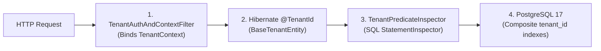

# 02 — Multi-Tenancy & Security Model

Data isolation between tenants is enforced at **four independent layers** so that a bug in a single layer cannot leak cross-tenant data.

---

## 1. Defense-in-Depth Multi-Tenancy

1. **Request Binding (`TenantContext` & `TenantAuthAndContextFilter`)**:
   - Every authenticated tenant request resolves `tenantId` from the verified JWT claim or `ApiToken` record and binds it to `TenantContext` (`ThreadLocal`) for the request lifecycle, clearing it in a `finally` block.
   - Asynchronous tasks propagate tenant context via `TenantAwareTaskDecorator`.
2. **ORM Partitioning (`BaseTenantEntity` & `@TenantId`)**:
   - All tenant-owned entities extend `com.ims.common.BaseTenantEntity` (or `VersionedTenantEntity` for optimistic locking via `@Version`).
   - `@TenantId` causes Hibernate 6 to automatically populate `tenant_id` on `INSERT` and append `WHERE tenant_id = ?` to `SELECT`, `UPDATE`, `DELETE`, and `JOIN` queries using `TenantIdentifierResolver`.
3. **Explicit `@GlobalEntity` Allowlist**:
   - ArchUnit (`DataAccessRulesTest`) requires **every** `@Entity` in `com.ims` to either extend `BaseTenantEntity` or carry `@GlobalEntity` and appear in `GLOBAL_ENTITY_ALLOWLIST` (`Tenant`, `UserAccount`, `RefreshToken`, `ApiToken`, `OutboxEvent`, `ExchangeRate`, `PlatformUser`, `Plan`, `PlanFeature`, `TenantSubscription`, `TenantFeatureOverride`, `TenantUsageSnapshot`, `SupportSession`, `PlatformAuditLog`).
4. **SQL Safety Net (`TenantPredicateInspector`)**:
   - Implements Hibernate `StatementInspector`. Before any SQL hits JDBC, it checks if the query references any of the 40+ tenant-scoped tables.
   - If `TenantContext.isBound()` is false, or if `tenant_id` is absent from the generated SQL (for non-`id=?` mutations), it **throws `IllegalStateException` and aborts execution**.

---

## 2. Dual Authentication Chains

`SecurityConfig` configures two ordered, stateless `SecurityFilterChain`s:

| Chain | Order | Matcher | Filter | Purpose |
| :--- | :--- | :--- | :--- | :--- |
| **Platform Operator** | `@Order(1)` | `/api/platform/**` | `PlatformAuthFilter` | Operator console login (`PlatformUser`) + `X-Proxy-Secret` verification |
| **Tenant Portal & API** | `@Order(2)` | All other paths | `TenantAuthAndContextFilter` | Tenant BFF JWTs, Support Impersonation JWTs, `ims_pat_*` API tokens, SSE tickets |

### 2.1 Tenant BFF Session Authentication
- Browser clients never hold JWTs in JavaScript. Next.js (`@ims/client` and `@ims/platform`) stores `HttpOnly`, `SameSite=strict` cookies and forwards requests with `Authorization: Bearer <jwt>` + `X-Proxy-Secret: <secret>`.
- Access tokens expire in `10` minutes (`ims.security.access-token-minutes`).
- Refresh tokens (`RefreshToken`) last **14 days** and rotate on every `/api/v1/auth/refresh` call. **Reuse detection**: if a previously rotated refresh token is replayed, the entire token family for that user is revoked.

### 2.2 Personal Access Tokens (`ims_pat_*`)
- External integrations and scripts authenticate with `Authorization: Bearer ims_pat_<secret>` (gated by `Feature.API_ACCESS`).
- Tokens are stored as SHA-256 hashes, carry explicit permission scopes (`Permission` codes) and optional expiry, and are throttled per minute according to `Feature.API_RATE_PER_MIN`.

### 2.3 Support Impersonation (`SupportSession`)
- Platform operators can start an audited 30-minute **read-only** support session for a target tenant.
- `TenantAuthAndContextFilter` honors the impersonation token's `tenantId` while restricting mutating HTTP methods so support staff can diagnose issues without altering tenant data.

---

## 3. Feature & Permission Enforcement

Every protected endpoint evaluates two independent gates:
1. **Plan Entitlement (`@RequiresFeature(Feature.X)`)**: Evaluated by `RequiresFeatureAspect` against `EntitlementFacade` (Plan defaults + active `TenantFeatureOverride`s). Returns HTTP `403` with `code: "FEATURE_NOT_ENABLED"` if absent.
2. **RBAC (`@PreAuthorize("hasAuthority('DOMAIN:ACTION')")`)**: Evaluated by Spring Security against the intersection of the user's assigned `Role` permissions and the tenant's enabled features (so disabled modules never grant active authorities).
