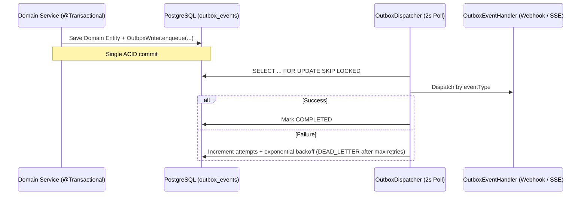

# 04 — Async Outbox, Audit Trail & Integrations

Cross-cutting reliability mechanisms ensure that audit records, outbound webhooks, SSE notifications, and file workflows remain consistent with database transactions.

---

## 1. Transactional Outbox (`com.ims.common.outbox`)

- **Why**: Direct HTTP webhook calls or SSE broadcasts inside a `@Transactional` method can fail or hang, and would fire even if the transaction later rolls back.
- **How**: Services call `OutboxWriter` inside the business transaction to insert an `OutboxEvent` (`@GlobalEntity`). `OutboxDispatcher` polls every `2000ms` (`ims.outbox.poll-interval-ms`) using `FOR UPDATE SKIP LOCKED` so multiple backend replicas never double-process the same event.
- **Dead-Letter Recovery**: Failed deliveries use exponential backoff and transition to `DEAD_LETTER` after max attempts; Platform operators can inspect and retry dead-lettered events from `@ims/platform`.

---

## 2. Automatic Hibernate Audit Trail (`com.ims.common.audit`)

- Annotate any entity class with `@Audited`.
- `AuditHibernateIntegrator` hooks into Hibernate `PostInsertEvent`, `PostUpdateEvent`, and `PostDeleteEvent` listeners via `AuditEventListener`.
- On update, only dirty properties are captured as `{ old, new }` JSON diffs; fields annotated with `@AuditIgnore` (e.g., `updatedAt`, `version`, password hashes, secret keys) are excluded.
- `AuditContext` supplies `actorId` and `actorEmail` from the active security principal.
- `AuditEvent` records are append-only (`AuditEventRepository` forbids updates/deletes).

---

## 3. Extension & Plugin SPIs

Cross-cutting engines discover domain capabilities via Spring-injected SPI implementations rather than hardcoding dependencies:

| SPI Interface | Package | Purpose |
| :--- | :--- | :--- |
| `SearchContributor` | `collaboration.spi` | Contributes domain entities to Command Palette `GlobalSearchService` |
| `ImportTargetHandler` | `collaboration.spi` | Registers preview/commit handlers for CSV/XLSX `ImportExportService` |
| `TabularExportPort` | `collaboration.spi` | Decouples tabular CSV/XLSX streaming from domain services |
| `TenantBootstrapContributor` | `identity.spi` | Seeds starter data (roles, sequences, default locations/categories) on tenant creation |
| `TenantUsageContributor` | `entitlement.spi` | Reports live entity counts (`MAX_USERS`, `MAX_PARTS`, `MAX_LOCATIONS`, `STORAGE_MB`, etc.) |
| `ReportDataProvider` | `integration.spi` | Supplies structured model data to Handlebars/OpenHTMLToPDF `ReportTemplate`s |

---

## 4. Security Hardening in I/O & Webhooks

- **S3 Presigned Uploads (`AttachmentService`)**: Files stream directly between browser and S3/MinIO via short-lived presigned URLs after checking `STORAGE_MB` quota; `confirm` finalizes metadata.
- **Bulk Import/Export Guards (`ImportExportService`)**: FastExcel reader enforces zip-bomb protection; CSV/XLSX exports sanitize cells starting with `=`, `+`, `-`, `@` to neutralize spreadsheet formula injection.
- **Outbound Webhooks (`WebhookSubscription`)**: Target URLs are validated against private/loopback/link-local IP ranges (SSRF guard) before dispatch, and payloads are signed with HMAC-SHA256.
