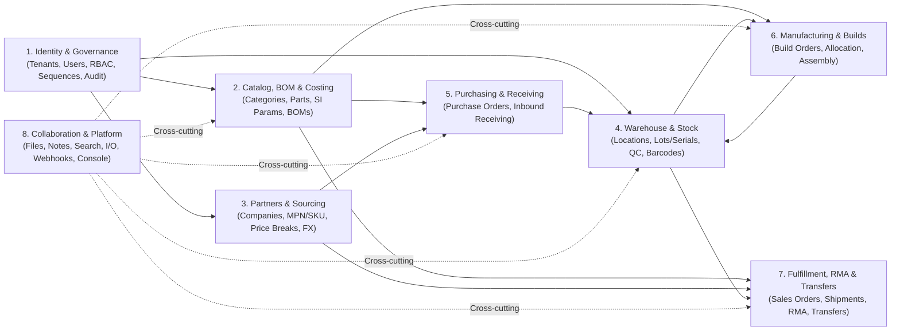
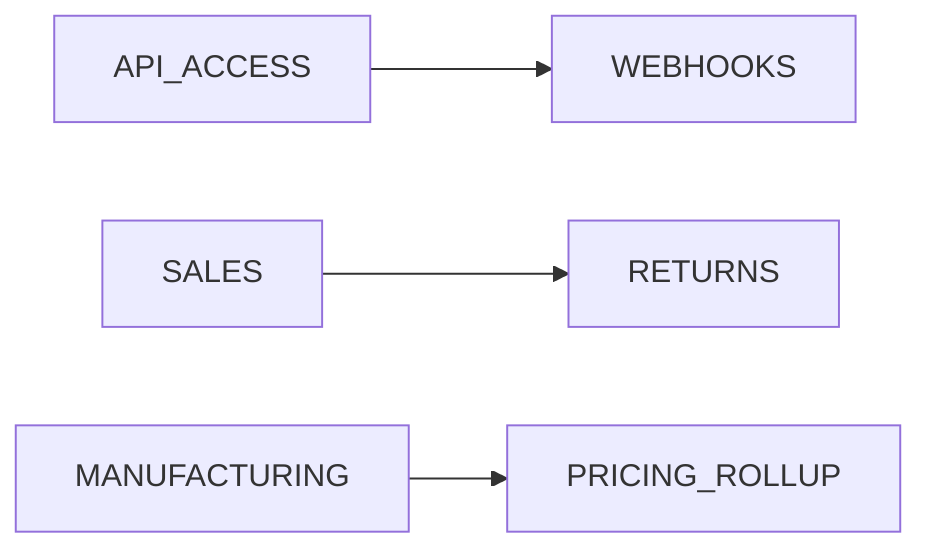

# 00 — Domain Map, Plans & Entitlements

The IMS platform spans **9 functional domains** organized from engineering master data through procurement, manufacturing, fulfillment, and platform operations.

---

## 1. End-to-End Domain Map

---

## 2. Subscription Plans & Feature Matrix

Entitlements are defined code-first in `com.ims.entitlement.spi.Feature` and configured per plan (`TRIAL`, `STARTER`, `PRO`, `ENTERPRISE`) in `PlanFeature` plus per-tenant `TenantFeatureOverride` records.

### 2.1 Core Always-On Modules
| Feature Key | Description |
| :--- | :--- |
| `PARTS` | Core Part Catalog & Categories |
| `STOCK` | Core Warehouse Locations & Stock Engine |
| `COMPANIES` | Core Companies & Supplier Catalog |

### 2.2 Gated Boolean Features & Dependency Graph

| Feature Key | Phase | Dependencies | Capability Unlocked |
| :--- | :--- | :--- | :--- |
| `API_ACCESS` | 0 | — | Scoped `ims_pat_*` Personal Access Tokens |
| `IMPORT_EXPORT` | 0 | — | Bulk CSV & XLSX preview/commit imports & tabular exports |
| `SERIAL_TRACKING` | 2 | — | Serialized `StockItem` tracking (`qty == 1`) & installation genealogy |
| `QUALITY_TESTS` | 2 | — | `PartTestTemplate` & `StockItemTestResult` QC pass/fail gates |
| `BARCODES` | 2 | — | QR / DataMatrix / Code128 generation & scan resolution |
| `MULTI_CURRENCY` | 3 | — | Foreign currency sourcing & `ExchangeRate` conversions |
| `PURCHASING` | 4 | — | `PurchaseOrder` lifecycle & inbound receiving |
| `MANUFACTURING` | 5 | — | Multi-level BOMs & `BuildOrder` production |
| `SALES` | 6 | — | Customer `SalesOrder`s & `SalesOrderShipment`s |
| `RETURNS` | 6 | `SALES` | `ReturnOrder` (RMA) intake & quarantine disposition |
| `TRANSFERS` | 6 | — | Two-stage inter-warehouse `TransferOrder`s |
| `PRICING_ROLLUP` | 7 | `MANUFACTURING` | Automated recursive BOM cost rollup |
| `CUSTOM_REPORTS` | 7 | — | Tenant-customizable Handlebars/OpenHTMLToPDF `ReportTemplate`s |
| `WEBHOOKS` | 7 | `API_ACCESS` | HMAC-SHA256 signed outbound webhooks |
| `REALTIME` | 7 | — | Live table refresh via Server-Sent Events (`/api/v1/events`) |

### 2.3 Quota Limits (`FeatureType.LIMIT`)
| Quota Key | Measured By | Enforced On |
| :--- | :--- | :--- |
| `MAX_USERS` | Active + pending-invite `UserAccount`s | User invitation |
| `MAX_PARTS` | Active `Part` count | Part creation / bulk import |
| `MAX_LOCATIONS` | `StockLocation` count | Location creation |
| `MAX_WEBHOOKS` | Active `WebhookSubscription` count | Webhook creation |
| `STORAGE_MB` | Sum of confirmed `Attachment` bytes | Presigned upload request |
| `API_RATE_PER_MIN` | Requests per minute per `ims_pat_*` token | `TenantAuthAndContextFilter` |

---

## 3. Plan & Override Evaluation Rules
- **Resolution Order**: `TenantFeatureOverride` (if not expired via `expiresAt`) overrides the tenant's active `PlanFeature` value.
- **Error Contract**:
  - Missing boolean feature -> `403 FORBIDDEN` (`code: "FEATURE_NOT_ENABLED"`, `feature: "<KEY>"`).
  - Quota exceeded -> `403 FORBIDDEN` (`code: "LIMIT_REACHED"`, `feature: "<KEY>"`, `limit`, `current`).
