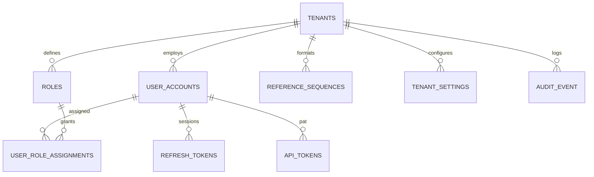

# 01 — Identity, Tenancy & Governance

Covers tenant onboarding, user lifecycle, dynamic RBAC, API tokens, customizable document numbering, organization settings, and immutable audit compliance.

---

## 1. Entity Model

---

## 2. Functional Requirements

### 2.1 Tenant Provisioning & Bootstrap
- **Self-Service Signup** (`POST /api/v1/auth/register-tenant`): Gated by `ims.signup.enabled` (`IMS_SIGNUP_ENABLED`). Creates `Tenant`, `TenantSubscription` (default `TRIAL`), initial admin `UserAccount`, and invokes all `TenantBootstrapContributor`s to seed system `Role`s, default `ReferenceSequence`s, and starter catalog/location records.
- **Operator Provisioning**: Platform operators can provision tenants regardless of `IMS_SIGNUP_ENABLED`.

### 2.2 User Lifecycle & Session Security
- **Invitations & Password Reset**: Admins invite users (`MAX_USERS` quota checked); invitees complete onboarding via `/api/v1/auth/accept-invite`. Self-service password reset uses `/api/v1/auth/forgot-password` and `/api/v1/auth/reset-password`.
- **Last-Admin Protection**: Users cannot deactivate or remove the admin role from the last active administrator of a tenant.
- **Rotating Refresh Tokens**: 14-day `RefreshToken` rotates on every refresh; replay of a consumed token revokes the user's active refresh chain.

### 2.3 Dynamic Feature-Filtered RBAC
- Permissions are granular (`PART`, `STOCK`, `COMPANY`, `BUILD`, `ORDER`, `ADMIN` × `VIEW`, `CREATE`, `UPDATE`, `DELETE` = 24 codes in `com.ims.identity.domain.model.Permission`).
- Effective authorities returned on `/api/v1/me` and enforced on requests are **filtered by the tenant's enabled features** so disabled modules never surface actionable permissions.
- System roles cannot be deleted; custom roles can be created, updated, and assigned by `ADMIN:*` users.

### 2.4 Personal Access Tokens (`ims_pat_*`)
- Gated by `Feature.API_ACCESS`.
- Tokens carry explicit permission subsets, optional expiration, and per-minute rate limits (`Feature.API_RATE_PER_MIN`). Plaintext secret is shown **once** at creation; only the hash and prefix are persisted.

### 2.5 Customizable Document Sequences & Settings
- `ReferenceSequence` generates collision-free sequential codes per document type (`PO`, `SO`, `BO`, `RMA`, `TRF`) with configurable prefix, zero-padding, and next-number counter.
- `TenantSetting` stores typed key/value organization preferences (e.g., base currency, company name, date/locale preferences).

### 2.6 Immutable Audit Log (`AuditEvent`)
- Captures create/update/delete diffs for `@Audited` entities (`Part`, `PartCategory`, `PurchaseOrder`, `BuildOrder`, etc.).
- Supports filtering by entity type, actor, action, and timestamp range, plus CSV export.

---

## 3. Business Invariants
- Tenant `slug` and user `email` (within tenant / global login) must be unique.
- `AuditEvent` records are strictly append-only; no API or repository method may mutate or delete them.
- Suspended or deleted tenants cannot obtain new access tokens or execute API calls.
