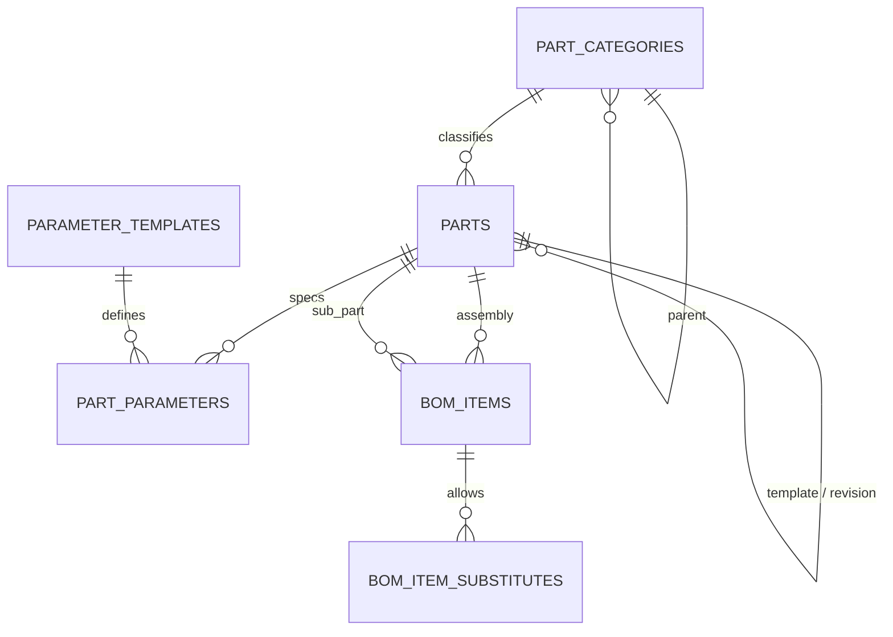

# 02 — Engineering Catalog, BOM & Costing

Manages hierarchical part classifications, part master records, SI-normalized engineering parameters, multi-level Bills of Materials (BOMs), and automated cost rollups.

---

## 1. Entity Model

---

## 2. Functional Requirements

### 2.1 Hierarchical Categories (`PartCategory` with PostgreSQL `ltree`)
- Tree structure persisted with materialized `ltree` paths for fast subtree queries (`<@` / `@>`).
- **Structural Categories**: Categories marked `structural = true` act as organizational folders and forbid direct `Part` assignment.
- **Move & Delete**: Moving a category updates its `ltree` path and all descendant paths atomically; deleting supports reparenting children or cascading removal (blocked if referenced parts remain unless cascaded).

### 2.2 Part Master (`Part`)
- Core fields: `name`, `ipn` (Internal Part Number), `description`, `revision`, `units`, `minimumStock`, `staleDays`.
- Capability flags: `active`, `virtual`, `template`, `assembly`, `component`, `trackable`, `purchaseable`, `salable`.
- **Template / Variant Inheritance**: A `template = true` part can parent multiple variant parts (`variantOfId`), allowing stock summaries and search to roll up across variants.
- **Revisions**: Parts can link to a `revisionOfId` predecessor for engineering revision history.

### 2.3 SI-Normalized Parameters (`ParameterTemplate` & `PartParameter`)
- Numeric parameters store raw display values/units alongside normalized **SI base-unit values** computed via JSR-385 (`Indriya`).
- Enables cross-unit engineering range queries (e.g., searching `100 nF` to `10 uF` matches `1 uF`, `470 nF`, and `0.0022 mF`).

### 2.4 Multi-Level BOM (`BomItem` & `BomItemSubstitute`)
- Gated by `Feature.MANUFACTURING` for build execution; defines required `subPartId`, `quantity`, `reference` designators, `overage`, `optional`, `consumable`, and `allowVariants`.
- Supports approved substitute parts (`BomItemSubstitute`) used during build allocation and `maxBuildable` calculations.
- **Where-Used**: Reverse BOM lookup identifies all parent assemblies consuming a given component.

### 2.5 Automated BOM Cost Rollup (`PartPricingService`)
- Gated by `Feature.PRICING_ROLLUP`.
- Recursively computes `minUnitCost` and `maxUnitCost` for any part:
  - Purchased parts: derived from active `SupplierPriceBreak`s converted to tenant base currency via `ExchangeRate`.
  - Assemblies: sums child BOM component costs (`quantity * (1 + overage)`) recursively across the BOM tree.

---

## 3. Business Invariants & Error Rules
- **Virtual vs. Purchaseable**: A `virtual = true` part **cannot** be `purchaseable = true` (`422 BusinessRuleException`).
- **BOM Cycle Prevention**: Adding or updating a `BomItem` that creates a direct or transitive cycle (`A -> B -> A`) is rejected (`422 BusinessRuleException`).
- **Structural Category Guard**: Assigning a `Part` to a `structural` `PartCategory` is rejected.
- **Quota**: Creating parts enforces `Feature.MAX_PARTS`.
