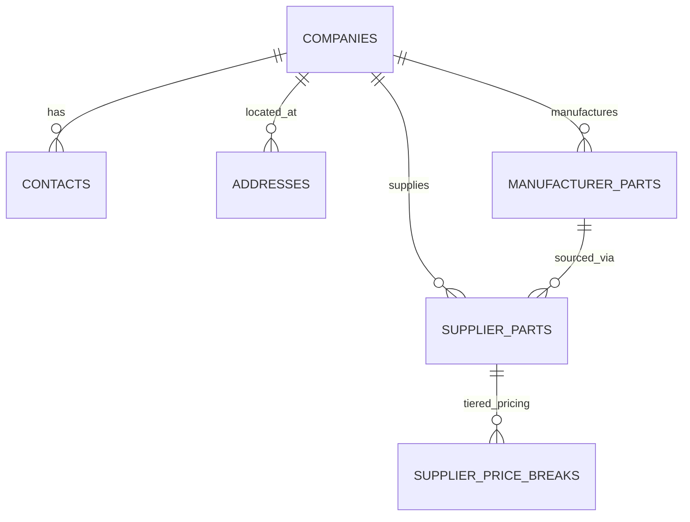

# 03 — Business Partners, Sourcing & Multi-Currency

Manages suppliers, manufacturers, customers, internal company entities, Approved Manufacturer/Vendor Lists (AML/AVL), tiered quantity price breaks, and FX exchange rates.

---

## 1. Entity Model

---

## 2. Functional Requirements

### 2.1 Companies, Contacts & Addresses (`Company`)
- Always-on core module (`Feature.COMPANIES`).
- A single `Company` can carry any combination of role flags: `supplier`, `manufacturer`, `customer`, `internalCompany`.
- Supports multiple `Contact` persons and typed `Address`es (primary/shipping/billing) with `isPrimary` designation.

### 2.2 AML & AVL (`ManufacturerPart` & `SupplierPart`)
- **Manufacturer Part (MPN)**: Links a `Part` to a `manufacturer` company and manufacturer part number (`mpn`), datasheet/link, and packaging details.
- **Supplier Part (SKU)**: Links a `Part` (and optional `ManufacturerPart`) to a `supplier` company with:
  - `sku` (supplier order code)
  - `packQuantity` (conversion factor from supplier pack to internal base units, e.g., 1 reel = 5000 pcs)
  - `moq` (Minimum Order Quantity), `multiple` (order increment), `leadTimeDays`, and `customBarcode`.

### 2.3 Tiered Pricing & Multi-Currency (`SupplierPriceBreak` & `ExchangeRate`)
- `SupplierPriceBreak` defines `(quantity, unitPrice, currency)` tiers per `SupplierPart`.
- Gated by `Feature.MULTI_CURRENCY` for non-base currencies: `ExchangeRate` (`@GlobalEntity`) converts supplier prices into the tenant's base currency, normalized by `packQuantity` for accurate unit costing and PO line auto-pricing.

---

## 3. Business Invariants
- A `Company` linked to a `PurchaseOrder` must have `supplier = true`; linked to a `SalesOrder` or `ReturnOrder` must have `customer = true`.
- `packQuantity` and `SupplierPriceBreak.quantity` must be strictly positive (`> 0`).
- `(supplierId, sku)` must be unique within a tenant.
