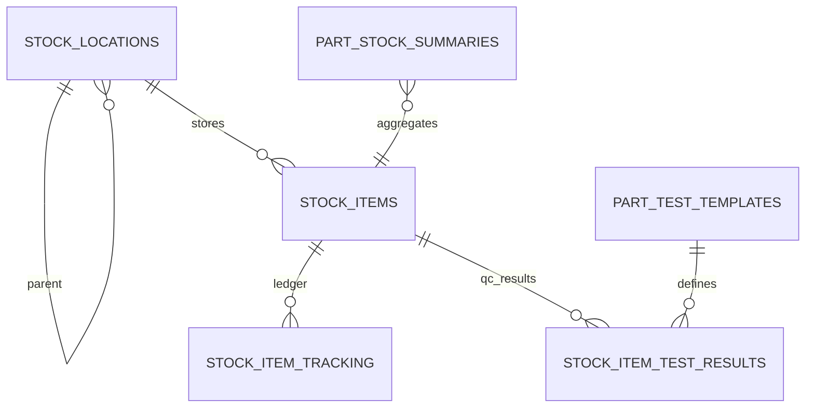

# 04 — Warehouse, Stock Engine, QC & Barcodes

Manages hierarchical warehouse locations, batch and serialized inventory lots, atomic stock movements, real-time stock summaries, quality control tests, and barcode generation/scanning.

---

## 1. Entity Model & Stock Statuses

`StockItem.Status` values: `OK`, `ATTENTION`, `DAMAGED`, `DESTROYED`, `REJECTED`, `LOST`, `QUARANTINED`, `RETURNED`, `IN_TRANSIT`.

A `StockItem` counts toward `inStock` only when `status` is `OK` or `ATTENTION`, `building == false`, `customerId == null`, and `installedInId == null`.

---

## 2. Functional Requirements

### 2.1 Warehouse Locations (`StockLocation` with `ltree`)
- Hierarchical tree (`Warehouse -> Aisle -> Rack -> Bin`) indexed with PostgreSQL `ltree` for fast subtree stock rollups.
- **Structural Locations**: `structural = true` locations cannot hold `StockItem`s directly.
- **External Locations**: `externalLocation = true` designates off-site/subcontractor storage.
- **Quota**: Creating locations enforces `Feature.MAX_LOCATIONS`.

### 2.2 Atomic Stock Operations (`StockService`)
All operations run inside `@Transactional`, append an immutable `StockItemTracking` entry, and queue deltas in `StockDeltaAccumulator`:
1. **`count`**: Stocktake adjustment setting exact quantity.
2. **`add`**: Increments lot quantity (blocked for serialized items).
3. **`remove`**: Decrements lot quantity (rejects negative resulting quantity).
4. **`transfer`**: Moves full or partial quantity to a non-structural destination `StockLocation` (auto-splits if partial).
5. **`split`**: Splits a batch lot into a child `StockItem` (`parentItemId` lineage preserved).
6. **`merge`**: Combines compatible batch lots into one target lot (locks source/target rows in ascending UUID order to avoid deadlocks).
7. **`serialize`**: Gated by `Feature.SERIAL_TRACKING`; converts batch quantity into individual `quantity = 1` serialized `StockItem`s for `part.trackable == true`.

### 2.3 Quality Control (`PartTestTemplate` & `StockItemTestResult`)
- Gated by `Feature.QUALITY_TESTS`.
- Defines expected test templates per `Part` (`required`, `requiresValue`, `requiresAttachment`, `choices`).
- Records timestamped pass/fail `StockItemTestResult`s against individual `StockItem`s.

### 2.4 Barcodes (`BarcodeService`)
- Gated by `Feature.BARCODES`.
- Generates **QR**, **DataMatrix**, and **Code128** PNG images for parts, locations, stock items, and orders.
- Unified scan endpoint resolves both IMS internal payloads and custom `customBarcode` strings on parts, locations, stock items, and supplier parts.

---

## 3. Business Invariants
- Serialized items (`serialNumber != null`) **must** have `quantity == 1` and belong to a `part.trackable == true` part.
- Stock cannot be placed in a `structural = true` `StockLocation`.
- `StockReconciliationJob` periodically recomputes `PartStockSummary` from `StockItem` ground truth to heal any drift.
