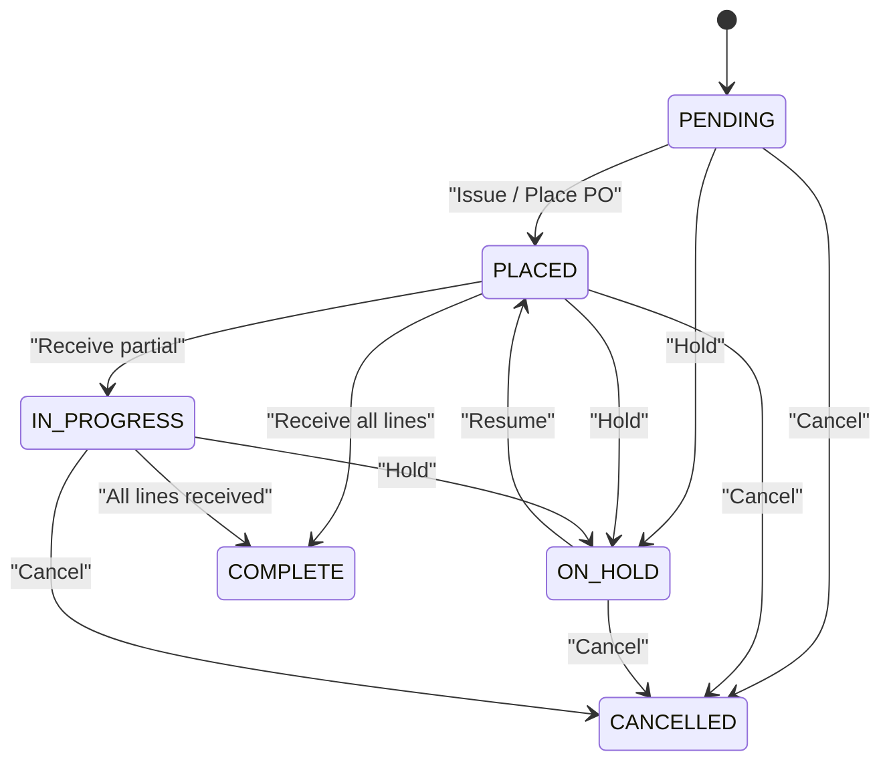

# 05 — Procurement & Inbound Receiving

Gated by `Feature.PURCHASING`. Manages supplier Purchase Orders (POs), automatic price-break resolution, extra charges, and inbound batch/serialized receiving into warehouse stock.

---

## 1. Purchase Order Lifecycle (`PurchaseOrder.Status`)

---

## 2. Functional Requirements

### 2.1 PO Creation & Line Auto-Pricing
- References are generated from the tenant's `PO` `ReferenceSequence`.
- `PurchaseOrderLineItem` links to a `SupplierPart` (and target `Part`).
- When `unitPrice` is omitted, the service resolves the best matching `SupplierPriceBreak` for the line quantity and converts currency if needed (`MULTI_CURRENCY`).
- `PurchaseOrderExtraLine` captures shipping, customs, or tooling fees.
- Issuing a PO (`PENDING -> PLACED`) increments `PartStockSummary.onOrder` by `quantity * packQuantity`.

### 2.2 Inbound Receiving
- Receiving a line item (`POST /api/v1/purchase-orders/{id}/receive`) converts received supplier packs into internal base units (`receivedQty * supplierPart.packQuantity`).
- Supports **batch** receiving (single `StockItem` with optional `batchCode` & `expiryDate`) and **serialized** receiving (`Feature.SERIAL_TRACKING`, creating one `quantity = 1` `StockItem` per serial number).
- Decrements `PartStockSummary.onOrder` and increments `inStock`.
- Transitions `PLACED -> IN_PROGRESS`, and automatically transitions to `COMPLETE` (setting `completeDate`) once all line items reach full received quantity.
- Generates printable PO HTML/PDF documents via `PurchaseOrderReportDataProvider`.

---

## 3. Business Invariants
- Target company must have `Company.supplier == true`.
- Receiving is permitted only when PO status is `PLACED` or `IN_PROGRESS`.
- Cancelling a `PLACED` or `IN_PROGRESS` PO releases remaining unreceived `onOrder` summary quantities.
- `COMPLETE` and `CANCELLED` are terminal states.
