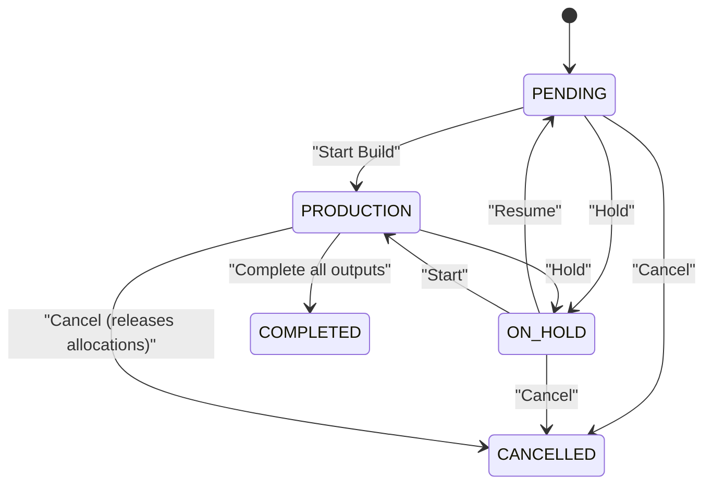

# 06 — Manufacturing & Build Orders

Gated by `Feature.MANUFACTURING`. Manages production work orders, BOM line explosion, recursive sub-assembly builds, component allocation, and serialized/batch output completion.

---

## 1. Build Order Lifecycle (`BuildOrder.Status`)

---

## 2. Functional Requirements

### 2.1 BOM Explosion, `maxBuildable` & Child Builds
- Creating a `BuildOrder` for an `assembly = true` `Part` explodes its `BomItem`s into `BuildLine`s (`quantity * bomItem.quantity * (1 + overage)`).
- **Max Buildable**: Computes how many finished assemblies can be produced from currently unallocated `OK` stock (including `BomItemSubstitute`s).
- **Recursive Child Builds**: Optionally spawns linked child `BuildOrder`s (`parentBuildId`) for sub-assemblies that lack sufficient available stock.

### 2.2 Component Allocation (`BuildAllocation`)
- **Manual & FIFO Auto-Allocation**: Allocates `OK`, non-expired `StockItem`s (optionally scoped to `sourceLocationId` subtree) using deterministic `FOR UPDATE` locking, incrementing `PartStockSummary.allocatedToBuild`.
- **De-allocation**: Cancelling or de-allocating releases `allocatedToBuild` back to available stock.

### 2.3 WIP Outputs, Serialization & Completion
- Starting/producing creates WIP `StockItem` outputs with `building = true` (`PartStockSummary.inProduction`), supporting serial numbers when `part.trackable == true`.
- **Serialized Component Installation**: For trackable components, allocated serials can be linked to the output assembly via `StockItem.installedInId` (preserving full as-built genealogy).
- **Completion**: Consumes allocated batch stock, clears `building = false` on completed outputs (`inProduction -> inStock`), updates `BuildOrder.completed`, and transitions to `COMPLETED` once `completed >= quantity`.

---

## 3. Business Invariants
- Target `Part` must have `assembly == true`.
- Cannot allocate more quantity from a `StockItem` than its unallocated available balance (`quantity - allocatedToBuild - allocatedToSales`).
- Completing a build requires outputs to meet or cover the build line requirements unless explicitly scrapped/cancelled.
