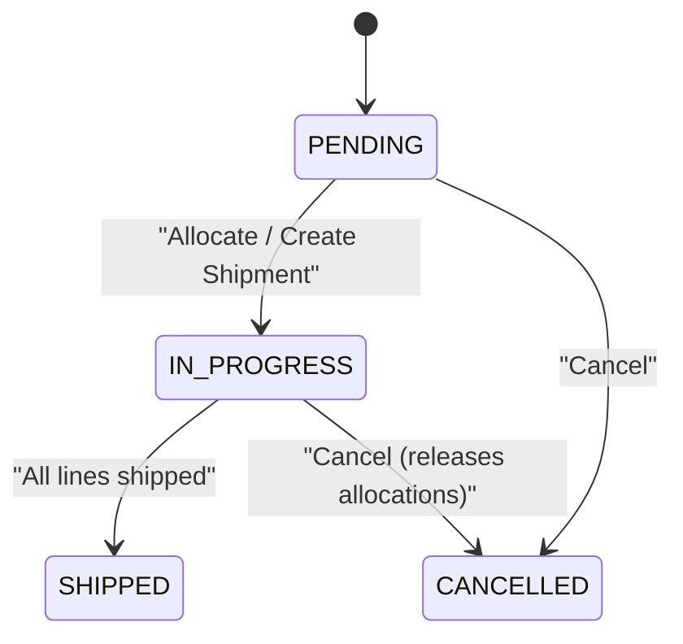
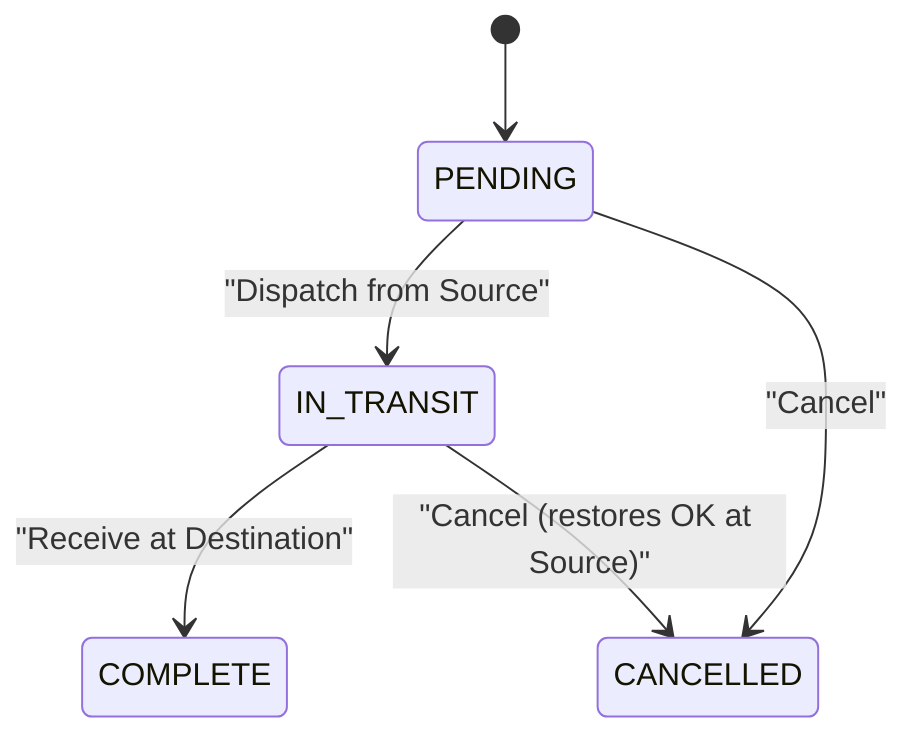

# 07 — Fulfillment, Returns & Transfers

Covers outbound customer fulfillment (`Feature.SALES`), customer Return Merchandise Authorizations (`Feature.RETURNS`), and two-stage inter-warehouse stock movements (`Feature.TRANSFERS`).

---

## 1. Order Lifecycles

### 1.1 Sales Order (`SalesOrder.status`)

### 1.2 Transfer Order (`TransferOrder.status`)

---

## 2. Functional Requirements

### 2.1 Sales Orders & Shipments (`SalesOrder`, `SalesOrderShipment`, `SalesOrderAllocation`)
- References generated via `SO` `ReferenceSequence`; customer must have `Company.customer == true`.
- Stock is reserved via `SalesOrderAllocation` (incrementing `PartStockSummary.allocatedToSales`) and grouped into `SalesOrderShipment`s.
- **Dispatch & Partial Lot Split**: Shipping a `SalesOrderShipment` deducts stock (auto-splitting a batch `StockItem` if only part of the lot is allocated), assigns `customerId` on shipped serialized/split items, releases `allocatedToSales`, and generates Packing List PDFs.

### 2.2 Return Orders (`ReturnOrder` — RMA)
- Gated by `Feature.RETURNS` (requires `Feature.SALES`).
- Linked to a `customer` (and optionally original `SalesOrder`).
- **Disposition**: Upon receipt, each `ReturnOrderLineItem` is dispositioned into warehouse stock with status `OK` (restocked), `QUARANTINED`, `DAMAGED`, or `REJECTED` (clearing `customerId` and updating `PartStockSummary`).

### 2.3 Two-Stage Warehouse Transfers (`TransferOrder`)
- Gated by `Feature.TRANSFERS`.
- **Stage 1 (Dispatch)**: Moves allocated `StockItem`s out of source availability by setting `status = IN_TRANSIT` so they cannot be double-allocated while on a truck.
- **Stage 2 (Receive)**: Moves items into `destinationLocationId` (non-structural) and restores `status = OK`, recording `StockItemTracking` entries at both stages.

---

## 3. Business Invariants
- `SalesOrder` cannot be shipped with unallocated/insufficient stock.
- `TransferOrder` `sourceLocationId` and `destinationLocationId` must be valid, non-structural locations.
- Cancelling an `IN_PROGRESS` `SalesOrder` releases all open `SalesOrderAllocation`s.
